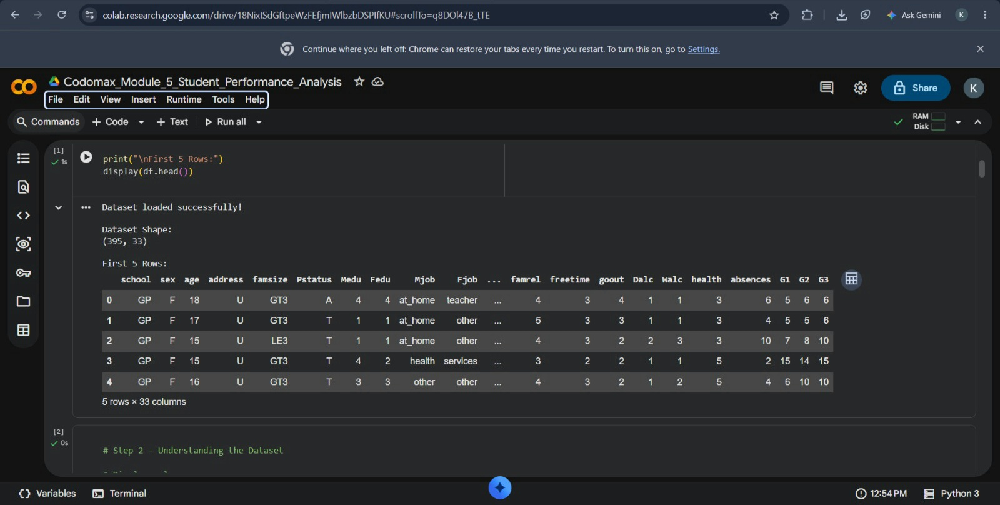
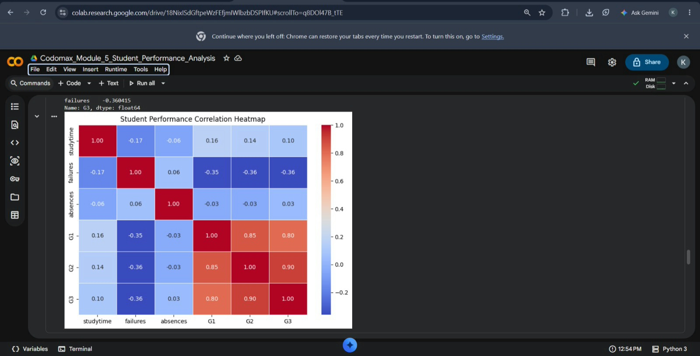
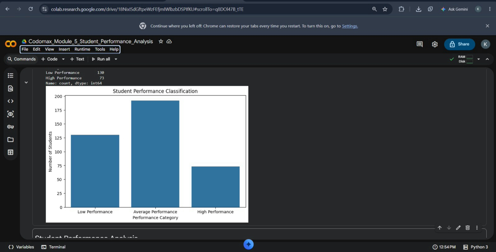
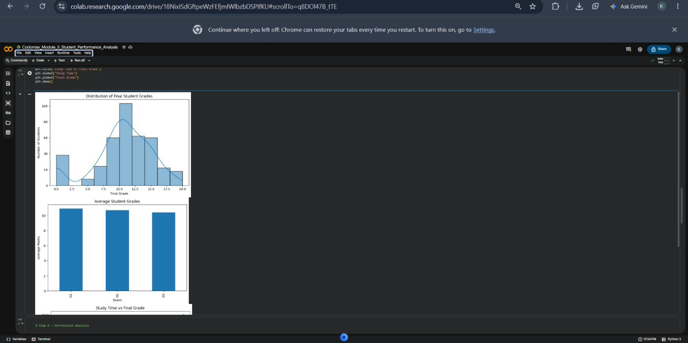

# Student Performance Analysis 📊

## Project Overview
This project analyzes student academic performance using Python. It explores student data, identifies performance patterns, and visualizes important academic insights.

## Dataset Information
- Dataset: Student Performance Dataset
- Total Records: 395
- Total Features: 33

## Technologies Used
- Python
- Pandas
- NumPy
- Matplotlib
- Seaborn
- Google Colab

## Project Steps
1. Dataset Loading and Exploration
2. Statistical Analysis
3. Data Cleaning and Preparation
4. Grade Analysis
5. Data Visualization
6. Correlation Heatmap
7. Student Performance Classification

## Key Results
| Performance Category | Students |
|---|---:|
| Low Performance | 130 |
| Average Performance | 192 |
| High Performance | 73 |

## Conclusion
The analysis shows that previous grades (G1 and G2) have a strong relationship with final grades (G3). Most students belong to the average performance category.

## Author
Karthik Kandula

B.Tech – Computer Science and Engineering (Data Science)

---

## 📸 Project Screenshots

### 1. Dataset Preview

### 2. Correlation Heatmap

### 3. Student Performance Classification

### 4. Grade Distribution Analysis

